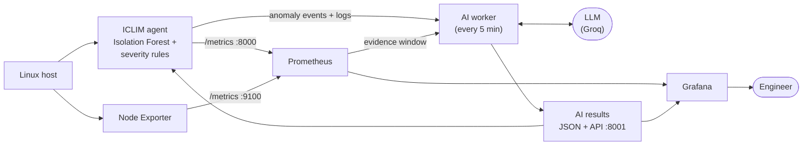

# ICLIM — Intelligent Cloud & Linux Infrastructure Monitor

**A single-node Linux monitoring platform that detects anomalies with machine learning, classifies their severity with deterministic rules, shows everything in Prometheus and Grafana, and uses an LLM to explain incidents and suggest what to investigate, without taking any action itself.**

Built incrementally over several months as a hands-on platform/SRE project: Python, Linux and systemd, scikit-learn, Prometheus, Grafana, Docker, Terraform on Azure, GitHub Actions, and an evidence-grounded AI layer.

---

## What it does

1. **Monitors** CPU, memory and disk on a Linux host every ~6 seconds.
2. **Detects** unusual behaviour with an Isolation Forest model that is retrained daily and hot-reloaded without downtime.
3. **Classifies severity** as UNUSUAL → WARNING → CRITICAL using persistence and resource impact, not the model's guess.
4. **Exposes metrics** to Prometheus (its own application metrics, plus host metrics from Node Exporter) and visualises them in Grafana.
5. **Explains incidents with AI.** A separate worker gathers evidence (the anomaly event, a 5-minute Prometheus window and agent logs) and asks an LLM for a structured explanation (*what happened, the evidence, what is unknown*) and investigation steps (*what to check next*).
6. **Keeps humans in charge.** The AI never runs commands, restarts services or claims a root cause the evidence does not support.



See **[docs/architecture.md](docs/architecture.md)** for the full design.

---

## Example: one incident, end to end

A controlled 40-second CPU load on the 1-vCPU CentOS VM:

| Anomaly duration | ICLIM severity | Why |
|---|---|---|
| 15–25 s | UNUSUAL | Anomalous, but not yet persistent (< 30 s) |
| 30–35 s | **CRITICAL** | Persistent (≥ 30 s) and CPU ≥ 90% |

The AI worker then produced:

- **Incident Explainer:** ICLIM recorded CPU at 100% while Prometheus showed ~84% for the same period. It reported this as a discrepancy it could not explain and rated evidence strength **MEDIUM**.
- **Operational Assistant:** investigation priority **HIGH**. It recommended checking per-process CPU, reviewing system and kernel logs, and checking disk I/O, and it listed the responsible process as *unknown*.

The difference comes from measurement windows: a 1-second sample versus a 1-minute rate. The AI did not have that information, so it correctly did not guess.

---

## Tech stack

| Area | Tools |
|---|---|
| Language and runtime | Python 3.12, virtualenv, YAML config, structured logging |
| Detection | psutil, scikit-learn Isolation Forest, pandas, joblib |
| Linux operations | CentOS Stream 9, systemd services and timers, journald, logrotate, firewalld |
| Observability | Prometheus 3.x, Node Exporter, custom `prometheus_client` exporter, PromQL, Grafana 13 (+ Infinity plugin) |
| AI | Groq API (`openai/gpt-oss-20b`), provider abstraction, JSON-schema-validated output |
| Containers | Docker, Docker Compose, named volumes |
| Cloud and IaC | Azure (VNet, NSG, Linux VM), Terraform with remote state in Azure Storage |
| CI/CD | GitHub Actions: CI, Terraform validation, full deploy-verify-destroy |

---

## Where it runs

| Environment | What runs there | Why |
|---|---|---|
| **CentOS Stream 9 VM** (local) | Full stack: 4 ICLIM units + 2 timers, Node Exporter, Prometheus, Grafana | Always-on runtime, zero cloud cost |
| **Azure Ubuntu VM** (ephemeral) | Containerised agent | Proves automated provisioning and deployment; destroyed after every run |

---

## Repository layout

```
agents/            realtime anomaly agent + Prometheus exporter
analysis/          model training, validation and bootstrap
ai/                context builder, Incident Explainer, Operational Assistant,
                   worker, result store, result API, LLM provider(s)
utils/             config loader, logger
config/            config.yaml
deploy/
  systemd/         every unit and timer running on the runtime VM, plus env template
  prometheus/      prometheus.yml
  grafana/         dashboard JSON + data source provisioning
terraform/         Azure infrastructure (VM, network, NSG) + remote backend
.github/workflows/ Pipeline A (CI), B (Terraform validation), C (deploy → verify → destroy)
docs/              architecture, components, deployment, decisions, security
scripts/           operational helpers (VM inventory)
archive/           earlier prototypes kept for history (log classifier, static dashboard)
```

---

## Getting started

**Try the agent locally (any OS with Python 3.12):**

```bash
git clone https://github.com/akashpagar1865/ICLIM.git && cd ICLIM
python -m venv venv && source venv/bin/activate      # Windows: venv\Scripts\Activate.ps1
pip install -r requirements.txt
python -m agents.realtime_anomaly_agent
```

On first run it collects 30 baseline samples, trains a model, and starts monitoring. Metrics are served at `http://localhost:8000/metrics`.

**Full stack on a Linux VM, or the Azure pipeline:** follow **[docs/deployment.md](docs/deployment.md)**.

---

## Documentation

| Document | Contents |
|---|---|
| [Architecture](docs/architecture.md) | Components, data flow, monitoring loop, AI path, CI/CD, diagrams |
| [Components](docs/components.md) | Each service: purpose, schedule, files, metrics, health checks |
| [Deployment](docs/deployment.md) | Step-by-step rebuild on CentOS/RHEL 9, and Azure pipeline setup |
| [Engineering decisions](docs/decisions.md) | Why it is built this way, plus known limitations and next steps |
| [Security](docs/security.md) | Controls in place and known gaps |

---

## Project status

**Functionally complete.** Monitoring, detection, model lifecycle, observability, CI/CD and the AI layer are implemented and validated on CentOS Stream 9.

This is a single-node, production-*inspired* portfolio project, not a hardened production service. It has no alert routing, no high availability and no autonomous remediation. Those boundaries are intentional and documented in [decisions.md](docs/decisions.md#known-limitations) and [security.md](docs/security.md).

---

## Author

**Akash Pagar**: moving into cloud, DevOps and SRE engineering after 6+ years in operations.

[LinkedIn](https://www.linkedin.com/in/akash-pagar-23316816b/) · [GitHub](https://github.com/akashpagar1865)
