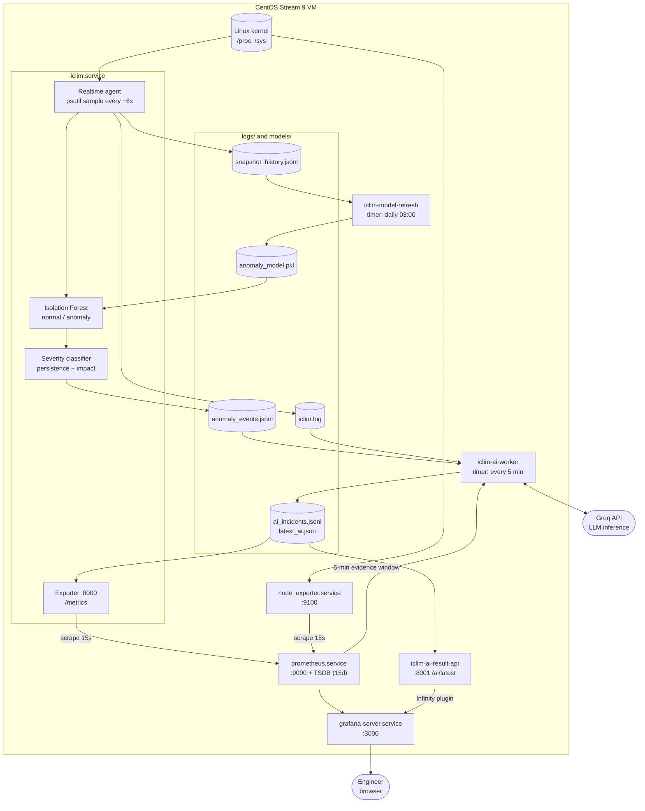
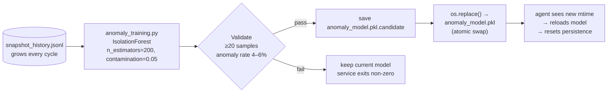
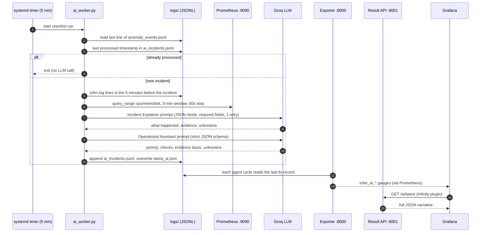
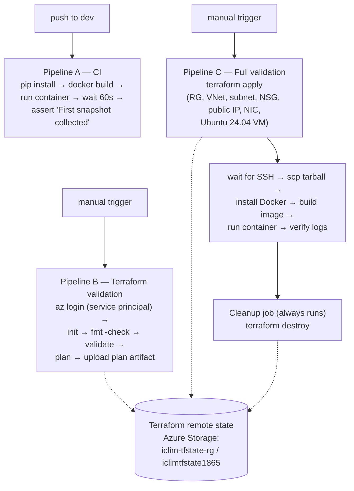

# ICLIM Architecture

This page explains the whole system in one place: what runs, where it runs, how data moves, and why it is split the way it is.

- For each service in detail, see [components.md](components.md).
- To rebuild it from scratch, see [deployment.md](deployment.md).

---

## 1. One-paragraph summary

ICLIM is a single-node Linux monitoring platform. A Python agent samples CPU, memory and disk every ~6 seconds. An Isolation Forest model decides whether each sample is anomalous, and a separate deterministic classifier assigns severity (UNUSUAL / WARNING / CRITICAL) based on persistence and resource impact. The agent exposes its own metrics to Prometheus, which also scrapes Node Exporter for host metrics. Grafana visualises both. A separate AI worker periodically takes the latest anomaly event, gathers evidence (Prometheus history and agent logs), and asks an LLM for a structured explanation and investigation steps. The result is published as bounded Prometheus metrics and as JSON through a small REST API, which Grafana displays. Humans decide and act; nothing is remediated automatically.

---

## 2. Two environments, two purposes

| | **Runtime environment** | **Deployment-proof environment** |
|---|---|---|
| Where | CentOS Stream 9 VM (VirtualBox, local) | Ubuntu 24.04 VM on Azure |
| Lifetime | Always on | Minutes. Created and destroyed by one pipeline run |
| What runs | Full stack: agent, model refresh, AI worker, AI API, Node Exporter, Prometheus, Grafana | Containerised agent only |
| Managed by | systemd units (`deploy/systemd/`) | Terraform + GitHub Actions + Docker |
| Purpose | Real monitoring, development and validation | Prove that infrastructure provisioning and deployment are automated and repeatable |

**Why split it this way:** keeping a VM running on Azure costs money every hour. The full stack runs locally for free. Azure is used only to prove that the agent can be provisioned, deployed and verified automatically. The pipeline then destroys everything, so the cloud bill stays near zero.

---

## 3. Runtime architecture (CentOS VM)

### The responsibility split

Each part answers a different question:

| Part | Question it answers |
|---|---|
| Node Exporter | What is happening to the Linux machine? |
| ICLIM agent and exporter | Is the ICLIM application healthy, and has it detected anything unusual? |
| Isolation Forest | Is this sample statistically unusual compared to recent history? |
| Severity classifier | How much does it matter? |
| Prometheus | How do we collect and keep this over time? |
| Grafana | How does a human see and investigate it? |
| AI layer | What does the evidence mean, and what should an engineer check next? |

The AI layer **does not detect anomalies and does not change anything on the system**. ICLIM remains the source of truth for timestamps, values, duration and severity.

---

## 4. The monitoring loop (what happens every ~6 seconds)

`agents/realtime_anomaly_agent.py`, running under `iclim.service`:

1. **Check the model file.** If `models/anomaly_model.pkl` has a new modification time, reload it and reset the persistence counter. This is how a nightly retrain takes effect without restarting the service.
2. **Take a snapshot.** CPU % (a 1-second `psutil` sample), memory %, root-disk %, hostname and timestamp.
3. **Update application metrics.** Increment `iclim_monitoring_cycles_total`, and refresh the AI-state gauges from the last line of `logs/ai_incidents.jsonl`.
4. **Predict.** Isolation Forest on `[cpu, mem, disk]` returns normal (`1`) or anomaly (`-1`).
5. **Append the snapshot** to `logs/snapshot_history.jsonl`. This is the training data for future models.
6. **If the sample is an anomaly:**
   - Increase the consecutive-anomaly count. Duration = count × configured interval (5s).
   - Classify severity:

     | Persistence | Any of CPU / MEM / DISK ≥ 90% | Any ≥ 80% | Otherwise |
     |---|---|---|---|
     | < 30 s | UNUSUAL | UNUSUAL | UNUSUAL |
     | ≥ 30 s | **CRITICAL** | **WARNING** | UNUSUAL |

   - Increment `iclim_anomaly_total{severity=…}`, write a log line, and append an event to `logs/anomaly_events.jsonl`.
7. **If the sample is normal:** reset the consecutive count.
8. Sleep 5 seconds (`config/config.yaml → app.interval`).

> A cycle actually takes about 6 s (1 s CPU sample + 5 s sleep), while duration is calculated as count × 5 s. Reported duration is therefore an estimate that runs slightly low. See [decisions.md](decisions.md#known-limitations).

---

## 5. Model lifecycle

- **Trigger:** `iclim-model-refresh.timer` runs every day at 03:00. `Persistent=true` means a run missed because the VM was off happens at the next boot.
- **First start:** if no history or model exists, `analysis/bootstrap.py` collects 30 live samples and trains an initial model before monitoring begins.
- **Why it exists:** a stale model trained on an older slice of history was flagging about 34.7% of samples as anomalies, against an expected 5%. The fix was to retrain regularly, not to tweak thresholds. See [decisions.md](decisions.md).

---

## 6. The AI incident path

Design points:

- **The AI is isolated from monitoring.** The agent never calls the LLM. If Groq is slow, down or returns bad output, monitoring is unaffected.
- **Two output paths.** Bounded state (result available, severity, priority) goes to Prometheus as gauges. Free text goes through the REST API. Putting free text in Prometheus labels would cause a cardinality explosion.
- **Grounded prompts.** Both prompts restrict the model to the supplied evidence. It must not claim a root cause or causation, must keep evidence, interpretation and unknowns separate, and must not recommend remediation.
- **Validated output.** Responses are parsed as JSON and checked for required fields. The Assistant also uses a strict JSON schema with enum values for severity and priority.

---

## 7. Data and file map

All paths are relative to the project directory (`/home/akashp/projects/ICLIM`).

| File | Written by | Read by | Notes |
|---|---|---|---|
| `config/config.yaml` | Human | Agent | Interval, hostname, paths. Env overrides: `INTERVAL`, `HOSTNAME`, `LOG_LEVEL` |
| `logs/snapshot_history.jsonl` | Agent (every cycle) | Model refresh | Training data. Grows continuously |
| `logs/anomaly_events.jsonl` | Agent (on anomaly) | AI worker | One JSON object per anomalous cycle |
| `logs/iclim.log` | Agent, training | AI worker (evidence) | Rotated to `iclim.log-YYYYMMDD.gz` |
| `models/anomaly_model.pkl` | Model refresh / bootstrap | Agent | Swapped atomically via `.candidate` |
| `logs/ai_incidents.jsonl` | AI worker | Exporter, worker (de-duplication) | History of all AI results |
| `logs/latest_ai.json` | AI worker | Result API | Latest AI result only |
| `/etc/iclim-ai-worker.env` | Human (root, 600) | AI worker unit | `GROQ_API_KEY`. Never committed |

---

## 8. Ports

| Port | Service | Endpoint |
|---|---|---|
| 8000 | ICLIM exporter (inside `iclim.service`) | `/metrics` |
| 8001 | AI Result API | `/ai/latest` |
| 9090 | Prometheus | UI + HTTP API |
| 9100 | Node Exporter | `/metrics` |
| 3000 | Grafana | UI |

---

## 9. Grafana dashboard: "ICLIM - Linux & Anomaly Monitoring"

Stored in `deploy/grafana/dashboards/iclim-dashboard.json`. It has three rows, which a reader goes through top to bottom:

| Row | Panels | Source |
|---|---|---|
| **Linux System Metrics** | CPU, memory, root filesystem utilisation | Node Exporter via PromQL |
| **ICLIM Agent Metrics** | Agent status, bootstrap status, model status, monitoring activity (`increase(cycles[5m])`), unusual / warning / critical anomalies (`increase(iclim_anomaly_total[5m])`) | ICLIM exporter |
| **AI Analysis** | AI result available, AI incident severity, AI investigation priority, incident explanation table, recommendations table | Gauges via Prometheus; tables via Infinity → `:8001/ai/latest` |

---

## 10. CI/CD and Azure deployment proof

- **Branch flow:** `feature/*` → validated on CentOS → `dev` (Pipeline A runs) → `main`.
- **Secrets:** `AZURE_CREDENTIALS` (service principal) and `SSH_PRIVATE_KEY` are stored as GitHub repository secrets.
- **Scope:** the Azure path deploys the **containerised agent only**. The Docker image predates the AI layer and does not include `ai/`. Prometheus, Grafana and the AI services run only on the CentOS runtime.
- **Cleanup always runs.** The destroy job uses `if: always()`, so infrastructure is removed even when the deploy fails.

---

## 11. Boundaries: what ICLIM is not

- **Single node.** It is not highly available and not a distributed monitoring system.
- **No alert routing.** There are no Prometheus alert rules and no Alertmanager. Detection is visible in Grafana and logs, but nobody gets paged. See [security.md](security.md) and [decisions.md](decisions.md).
- **No autonomous action.** The AI explains and recommends; a human investigates and acts.
- **Evidence strength is not a probability.** HIGH / MEDIUM / LOW describes how consistent the evidence is, not a calibrated confidence score.
